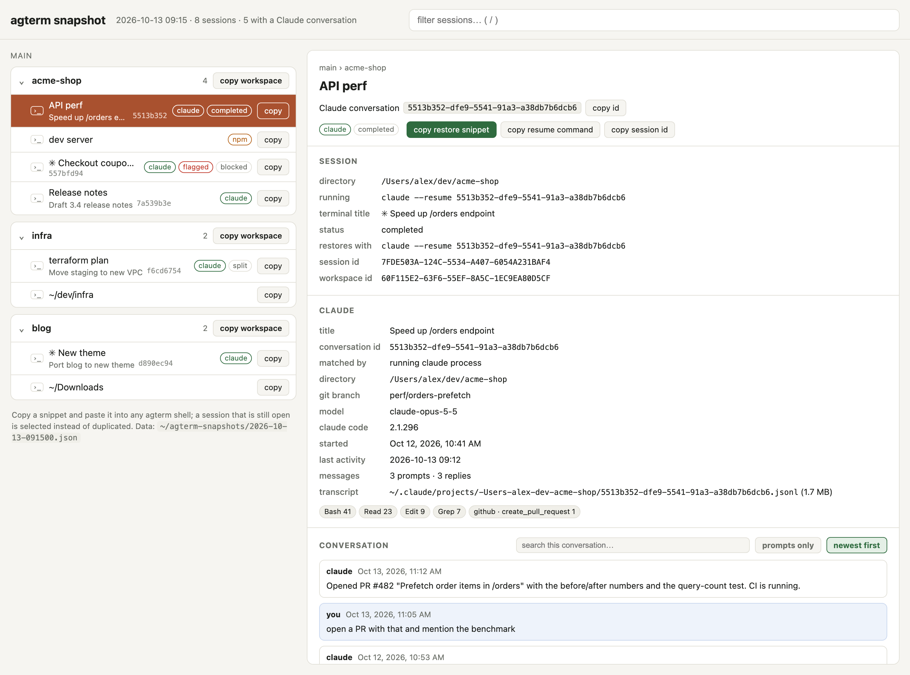

# agterm-session-kit

Scripts for [agterm](https://agterm.com) users who keep many workspaces and sessions, most of them running
Claude Code. They let you:

- **snapshot** the whole sidebar tree into a browsable HTML page, with each session's directory, running
  command, Claude conversation and last screen lines;
- **restore** any session or workspace on demand by pasting a one-line snippet copied from that page;
- **upgrade** agterm without losing track of which Claude conversation ran in which session.



Closing a session frees the memory of everything it runs. The snapshot is what lets you close sessions
freely and bring back the ones you need later, each with its own conversation, even when several share a
directory.

## Requirements

- macOS with agterm installed (`/Applications` or `~/Applications`, or set `AGTERMCTL`)
- `jq` and `python3` (both ship with recent macOS / Command Line Tools)
- `fish`, only for the optional `claude` wrapper

## Install

```sh
git clone <this repo> ~/dev/agterm-session-kit
cd ~/dev/agterm-session-kit
./install.sh                    # links bin/* into ~/.local/bin
./install.sh --fish             # also installs the fish `claude` wrapper
./install.sh --fish --force     # replace files the kit did not create (each is backed up as .bak.<time>)
./install.sh ~/bin              # install somewhere else
```

Re-running is safe: links that already point at the kit are left as they are. Without `--force`, an existing
command of the same name or a different `claude.fish` is skipped with a message rather than overwritten.

Optional: run the snapshot from agterm's command palette by adding to `~/.config/agterm/keymap.conf`:

```
command "snapshot sessions"  ~/.local/bin/agt-snapshot --open
```

## Commands

| command | what it does |
|---|---|
| `agt-snapshot [--open]` | saves `~/agterm-snapshots/<stamp>.json` + `.html`, `latest.html` points to the newest |
| `agt-restore [--dry-run] SNAP.json ID...` | recreates sessions; a session still open is selected instead |
| `agt-restore [--dry-run] SNAP.json --workspace WS_ID` | recreates every session of a workspace |
| `agt-resume-open [--dry-run] [SNAP.json]` | after a restart: types the restore line into each snapshot session that is open again but idle at a prompt |
| `agt-upgrade` | backs up agterm state, `brew upgrade --cask agterm`, relaunches. Run from Terminal.app after quitting agterm |

You rarely type `agt-restore` yourself: the HTML page has a **copy** button per session and per workspace that
puts the exact command on the clipboard. Paste it into any agterm shell.

Click a session to open its details beside the tree (full screen on a narrow window): directory, running
command, ids, the Claude conversation's title, branch, model, tools used and its message timeline (your
prompts and Claude's replies, searchable, newest first), plus the last 60 screen lines. ↑/↓ moves between
sessions, Esc closes, `/` focuses the filter, and the URL hash links straight to a session.

Snapshots go to `~/agterm-snapshots`; set `AGT_SNAP_DIR` to change it.

## How a session is restored

`agt-restore` creates a new session in the frontmost window, in the workspace with the same name (created if
missing), with the saved name and directory, then types one line into each pane:

1. if a running Claude was found in the pane, `claude --resume <conversation-id>`, even under a wrapper
   such as `caffeinate -i claude`;
2. else the program it was running (`make dev-watch`, `./bin/server`, `bash ./watch.sh`), as captured;
3. else, for a conversation found only through the fish wrapper's naming, `claude --resume <id>`;
4. else nothing, a plain shell.

The conversation is found, in order, from:

1. a live Claude Code session in `~/.claude/sessions/*.json` whose process carries the agterm session's
   `AGTERM_SESSION_ID` (works whatever the process is called: native `claude`, npm `node`, an SDK host).
   `AGTERM_PANE` / `AGTERM_PANE_ID` say whether it runs in the main pane or the split; scratch and overlay
   processes are ignored, and so is a headless `claude -p` or SDK child of another Claude;
2. `--resume`/`--session-id` in the pane's running command;
3. for the main pane, a transcript named after the agterm session id, which is what the fish wrapper creates.

Pasting a restore line twice does not duplicate anything: a session already restored from that snapshot
(recorded in `<snapshot>.restored.tsv`) is selected, and one whose conversation a running Claude already holds
is skipped. A line holding control characters is printed for you to run by hand instead of typed.

The page shows the conversation id in every row and at the top of the details panel, with **copy id** and
**copy resume command** (`cd <dir> && claude --resume <id>`, usable in any terminal or pasted to Claude), and
says which rule matched. Resuming by id keeps several conversations in one directory apart, where
`claude --continue` would pick the newest. A session with no match lists the five most recent conversations
started in its directory, each with its own resume command, and a conversation open in two sessions at
once is flagged **shared**, since two Claude processes writing to it interleave its history.

## The fish `claude` wrapper

`fish/claude.fish` pins each agterm tab to its own conversation: inside agterm, plain `claude` starts
`--session-id <tab id>` the first time and `--resume <tab id>` afterwards. With agterm's
*Re-run commands* restore mode, a restart replays the tab's `claude` and lands back in the same conversation.
Explicit `--resume`, `--continue`, `-p` and subcommands pass through untouched.

## Upgrading agterm

Quitting agterm ends every shell and agent in it. The conversations are saved on disk, so nothing is lost,
but take a snapshot first so you can bring each one back to its own session:

```sh
agt-snapshot          # inside agterm
# Cmd-Q to quit agterm, then in Terminal.app:
agt-upgrade
# back in agterm, once sessions are restored:
agt-resume-open --dry-run   # check
agt-resume-open
```

Window and session state lives in `~/Library/Application Support/agterm/` and survives the upgrade;
`agt-upgrade` also copies it into the snapshot directory first. To roll back the state, quit agterm and copy
the backup back into that folder.

## What is not restored

- scrollback and the live processes: a restored session is a new shell running the saved line
- windows that were closed when the snapshot was taken (`tree` only reports open windows)
- scratch terminals and overlays

## Privacy

Snapshots hold full command lines, the last screen lines of every session and up to 200 messages of each Claude
conversation, any of which can include tokens or keys. The snapshot directory is kept `0700` and files are created
`0600`; `.gitignore` excludes them. Do not commit or share a snapshot. Set `AGT_SNAP_TURNS=0` to leave
conversation text out (titles, ids and counts are still recorded).

## Notes

`docs/discussion-suspend.md` is a draft agterm feature request for a built-in suspend/resume of sessions and
workspaces, which would make most of this kit unnecessary.
